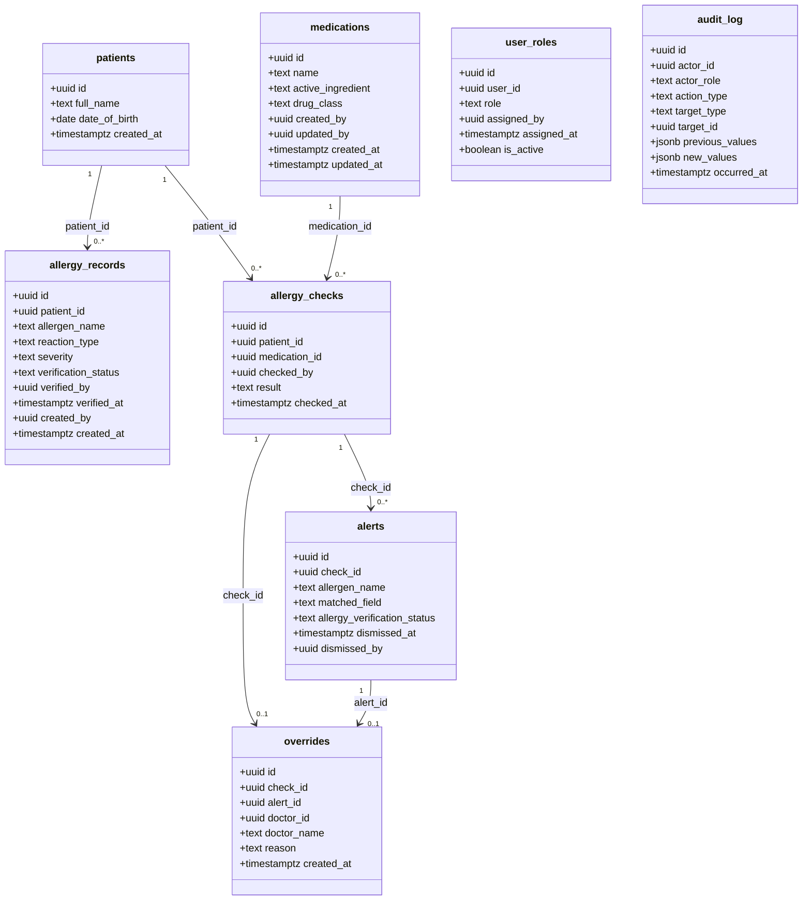

# Design Document

## EDAAS: Emergency Drug Allergy Alert System

---

## Overview

EDAAS is an educational decision-support prototype that helps healthcare staff identify
drug-allergy conflicts before medication is dispensed. It is built on a React + TypeScript
single-page application (SPA) backed by Supabase (Postgres, Auth, RLS, and server-side
RPC functions). The system enforces a strict fail-safe policy: any ambiguous or error
state results in dispensing being blocked.

All data is fictional. The system is not for clinical use. Healthcare professionals always
make the final decision; EDAAS never replaces clinical judgment.

---

## Architecture

### High-Level Layers

```
┌─────────────────────────────────────────────────────────────┐
│                    Browser (SPA)                            │
│  ┌─────────────┐  ┌────────────────┐  ┌──────────────────┐ │
│  │  Pages /    │  │    Feature     │  │  Auth / Role     │ │
│  │  Routes     │  │  Components    │  │  Context         │ │
│  └──────┬──────┘  └───────┬────────┘  └────────┬─────────┘ │
│         │                 │                    │            │
│         └─────────────────┼────────────────────┘            │
│                           │                                 │
│               ┌───────────▼──────────┐                     │
│               │   Service Layer      │                     │
│               │  (Supabase client,   │                     │
│               │   RPC wrappers,      │                     │
│               │   AbortController)   │                     │
│               └───────────┬──────────┘                     │
└───────────────────────────┼─────────────────────────────────┘
                            │ HTTPS / JWT
┌───────────────────────────▼─────────────────────────────────┐
│                       Supabase                              │
│  ┌───────────┐  ┌────────────┐  ┌──────────────────────┐   │
│  │   Auth    │  │  Postgres  │  │  RPC (SECURITY       │   │
│  │ (JWT,     │  │  + RLS     │  │  DEFINER functions)  │   │
│  │  sessions)│  │  policies  │  │                      │   │
│  └───────────┘  └────────────┘  └──────────────────────┘   │
└─────────────────────────────────────────────────────────────┘
```

### Client/Server Boundary

The client is **never trusted for role decisions**. All access control is enforced
server-side via:
- `has_role()` — a `SECURITY DEFINER` Postgres function called by every RPC before
  performing any action.
- RLS policies — applied to every table so that each database operation is validated
  against the caller's role, independent of any client-side check.

Frontend role context is used only for UI rendering (showing or hiding controls). Every
sensitive action is independently verified on the server; the client cannot bypass this.

### Admin Account Management Edge Function

Admin account creation and deactivation are handled by a dedicated Supabase Edge Function
(`admin-user-management`) that uses the **service-role key server-side only**. The
service-role key is never present in client code or environment variables accessible to
the browser.

**Account creation flow:**
1. Admin calls the Edge Function with `{action: 'create', full_name, email, password, role}`.
2. Edge Function validates the caller is an admin via `has_role()` (using the service-role
   key to query `user_roles`).
3. Calls `supabase.auth.admin.createUser({email, password, user_metadata: {full_name}})`.
4. The `on_auth_user_created` trigger fires, creating `profiles`, `user_roles`
   (role='patient'), and `patients` rows.
5. Edge Function then updates `user_roles.role` to the requested staff role
   (doctor/nurse/pharmacist) and `user_roles.assigned_by` to the admin's user ID.
6. Writes an `audit_log` entry (action_type = 'role_assigned').
7. Returns `{success: true, user_id}`.
8. The "admin" role is never a valid value for the `role` parameter; the Edge Function
   rejects any such request.

**Account deactivation flow:**
1. Admin calls the Edge Function with `{action: 'deactivate', target_user_id}`.
2. Edge Function validates caller is admin.
3. Sets `user_roles.is_active = false` for target user.
4. Calls `supabase.auth.admin.signOut(target_user_id, 'others')` to revoke all active
   sessions.
5. Writes an `audit_log` entry (action_type = 'account_deactivated').
6. Returns `{success: true}`.

---

### Frontend Layers

| Layer | Responsibility |
|---|---|
| **Pages / Routes** | Top-level route components (e.g. `/check`, `/allergies`, `/admin`). Each page owns its own data-fetching lifecycle. |
| **Feature Components** | Business-logic UI components (e.g. `ConflictAlertModal`, `AllergyHistoryPanel`). Receive state as props; emit events upward. |
| **Service Layer** | Thin wrappers around `supabase.rpc()` and `supabase.from()`. Responsible for timeouts (AbortController at 5 s), error normalisation, and typed response shapes. |
| **Auth / Role Context** | React context that exposes the current user's JWT-verified session and role. Populated on login; used for UI-only gating (never for security). |

### Backend Layers

| Layer | Responsibility |
|---|---|
| **Postgres Tables** | Canonical data store. Eight tables; see Data Models section. |
| **RLS Policies** | Row-level rules enforced by Postgres on every query. See RLS Policy Matrix. |
| **RPC Functions** | `SECURITY DEFINER` stored procedures called via `supabase.rpc()`. Perform role validation, business logic, and audit writes atomically. |
| **Supabase Auth** | Manages JWT issuance, session lifecycle, and account deactivation. |

---

## Components and Interfaces

### Frontend Components

#### `PendingConflictsPage`
Doctor-facing page showing all `allergy_checks` where `result = 'conflict'` and no
`overrides` row exists for that `check_id`.

- Displays: patient name (via `patients.full_name`), medication name (via
  `medications.name`), allergen name (from `alerts`), matched field, severity,
  verification status, and the `checked_at` timestamp.
- Clicking a row opens the `OverrideForm` for that check.
- Available to doctors only; non-doctors are rejected server-side via `has_role()`.

#### `MedicationCheckPage`
Orchestrates the entire check flow. Owns a state machine:

```
idle → checking → { conflict | safe | error }
```

- On submit: calls the `checkMedication` service with a 5-second AbortController.
- On `conflict`: renders `ConflictAlertModal`; dispense button is disabled.
- On `safe`: renders safe result; dispense button is enabled.
- On `error` / timeout / network failure: renders `FailSafeDialog`; dispense button is disabled.
- Dispense button is only enabled when state is `safe` OR (`conflict` AND an override
  has been recorded for this specific `check_id`).
- **Realtime subscription**: after a conflict result is received, `MedicationCheckPage`
  subscribes to Supabase Realtime on the `overrides` table filtered by `check_id`. When
  a new `overrides` row is inserted for the current `check_id`, the page transitions from
  `conflict` to override-received, dismisses `ConflictAlertModal`, and enables the
  dispense button — without requiring a page refresh.
- **Polling fallback**: if the Realtime subscription cannot be established,
  `MedicationCheckPage` falls back to polling `overrides` for the current `check_id`
  every 3 seconds until an override is found or the pharmacist cancels.

#### `ConflictAlertModal`
Full-screen modal dialog. Displayed exclusively when a conflict is detected.

- Shows: patient name, allergen name, medication name, conflict reason (name / ingredient /
  class match), allergy severity, and Verification_Status.
- Contains an inline `OverrideForm` for doctor role only.
- Cancel button: closes modal but **does not enable dispensing**.
- The text "Safe to proceed" is never rendered while this modal is visible.
- Cannot be dismissed by clicking outside or pressing Escape — an explicit user action is required.

#### `OverrideForm`
Rendered inside `ConflictAlertModal`, visible only when the current user holds the
`doctor` role (checked via Auth/Role context; also enforced server-side).

- Reason field: free-text input; validated client-side to 10–500 characters before
  submission.
- On submit: calls `overrideCheck` service; on success the modal is dismissed and
  `MedicationCheckPage` transitions to enable the dispense button for that `check_id`.

#### `FailSafeDialog`
Full-screen blocking dialog shown on timeout, RPC error, or network failure.

- Displays the specific reason (timeout / error / network unavailable).
- Requires an explicit user action (e.g. a "Retry" or "Dismiss" button) to close.
- Dispense button remains disabled while this dialog is visible.

#### `AllergyHistoryPanel`
Displays allergy records for a selected patient.

- Available to doctor, pharmacist, and nurse.
- Records ordered by `created_at` descending.
- Edit and verify/reject controls rendered only for doctor role.
- Nurse sees a read-only view with no action controls.

#### `PatientAllergyForm`
Allows a patient to add self-reported allergy entries.

- Fields: allergen name (1–100 chars), reaction type (enum), severity (enum).
- Saved with `verification_status = 'unverified'`.
- Patients can view only their own records (enforced by RLS and RPC).

#### `AllergyRegistrationForm`
Used by doctors, pharmacists, and admins to add allergy records on behalf of a patient.
Available to doctors, pharmacists, and admins only. Nurses have read-only access per
Requirement 10 and are not shown this form; the server rejects any allergy-record insert
attempted by a nurse.

- Fields: patient identifier, allergen name (1–100 chars), reaction type, severity.
- Duplicate detection: rejected if same patient + allergen name already exists.

#### `AdminMedicationManager`
Admin-only CRUD interface for the `medications` table.

- Add: requires name, active ingredient, drug class (all 1–100 chars).
- Edit: updates stored values; changes take effect on next allergy check.
- Delete: removes medication from database.
- All actions write to audit_log.

#### `AdminUserManager`
Admin-only interface for user account management. Calls the `admin-user-management`
Edge Function rather than the Supabase client directly.

- Create: requires full name, unique email, password (8–128 chars), role (doctor / nurse /
  pharmacist only — "admin" is not a selectable option). Account creation also inserts a
  `profiles` row via the `on_auth_user_created` trigger.
- Deactivate: sets `is_active = false`; terminates any active session.
- The "admin" role is never shown as an option in the creation UI.

#### `AuditLogViewer`
Admin-only read-only view of the `audit_log` table.

- Entries displayed in descending `occurred_at` order.
- No edit or delete controls exposed anywhere in the UI.

### Service Layer Interface (TypeScript shapes)

```typescript
// Returned by checkMedication RPC wrapper
type CheckResult =
  | { result: 'no_conflict'; zero_allergies: boolean }
  | { result: 'conflict'; check_id: string; alerts: AlertDetails[]; highest_severity: 'mild' | 'moderate' | 'severe' }
  | { result: 'error'; reason: 'timeout' | 'rpc_error' | 'network' };

type AlertDetails = {
  check_id: string;
  alert_id: string;
  allergen_name: string;
  matched_field: 'name' | 'active_ingredient' | 'drug_class';
  allergy_verification_status: 'unverified' | 'verified';
  severity: 'mild' | 'moderate' | 'severe';
  patient_name: string;
  medication_name: string;
};

// Returned by overrideCheck RPC wrapper
type OverrideResult =
  | { success: true; override_id: string }
  | { success: false; error: string };

// Returned by dispenseMedication RPC wrapper
// Returns {error: 'already_dispensed'} or {error: 'check_blocked'} when appropriate.
type DispenseResult =
  | { success: true }
  | { success: false; error: string };

// Returned by blockMedication RPC wrapper
type BlockResult =
  | { success: true }
  | { success: false; error: string };
```

---

## Data Models

### `profiles`

| Column | Type | Constraints | Purpose |
|---|---|---|---|
| `id` | uuid | PK, FK → auth.users.id | Mirrors the auth user; created by trigger on sign-up |
| `full_name` | text | NOT NULL, CHECK (char_length ≥1 AND ≤100) | Display name used in overrides, audit entries, and staff account creation |
| `created_at` | timestamptz | DEFAULT now() | Profile creation timestamp |

Note: `profiles.id` equals `auth.users.id`. Updated by `AdminUserManager` on account creation. Also created automatically by the sign-up trigger (see Change 3).

---

### `patients`

| Column | Type | Constraints | Purpose |
|---|---|---|---|
| `id` | uuid | PK, DEFAULT gen_random_uuid() | Unique patient identifier |
| `patient_code` | text | NOT NULL, UNIQUE, e.g. 'P-1001' | Human-readable patient reference code |
| `full_name` | text | NOT NULL | Patient display name |
| `date_of_birth` | date | NOT NULL | Patient date of birth |
| `user_id` | uuid | FK → auth.users.id, nullable, UNIQUE | Links the patient record to an auth user for self-service access; null for patients who do not have a portal account |
| `created_at` | timestamptz | DEFAULT now() | Record creation timestamp |

**RLS scoping note:** Patient self-service RLS policies on `patients` use `patients.user_id = auth.uid()`. RLS policies on `allergy_records` for the patient role use a join: `EXISTS (SELECT 1 FROM patients p WHERE p.id = allergy_records.patient_id AND p.user_id = auth.uid())`.

---

### `allergy_records`

| Column | Type | Constraints | Purpose |
|---|---|---|---|
| `id` | uuid | PK, DEFAULT gen_random_uuid() | Unique record identifier |
| `patient_id` | uuid | FK → patients.id NOT NULL | Owning patient |
| `allergen_name` | text | NOT NULL, CHECK (char_length ≥1 AND ≤100) | Allergen substance |
| `reaction_type` | text | NOT NULL, CHECK IN ('rash','swelling','anaphylaxis','nausea','respiratory distress') | Type of allergic reaction |
| `severity` | text | NOT NULL, CHECK IN ('mild','moderate','severe') | Severity level |
| `verification_status` | text | NOT NULL, DEFAULT 'unverified', CHECK IN ('unverified','verified','rejected') | Clinical review state |
| `verified_by` | uuid | FK → auth.users, nullable | Doctor who reviewed the record |
| `verified_at` | timestamptz | nullable | When verification occurred |
| `created_by` | uuid | FK → auth.users NOT NULL | User who created the record |
| `created_at` | timestamptz | DEFAULT now() | Record creation timestamp |

**Unique index**: `CREATE UNIQUE INDEX ON allergy_records (patient_id, lower(allergen_name))` — prevents duplicate allergy entries for the same patient using case-insensitive allergen name comparison.

---

### `medications`

| Column | Type | Constraints | Purpose |
|---|---|---|---|
| `id` | uuid | PK, DEFAULT gen_random_uuid() | Unique medication identifier |
| `name` | text | NOT NULL, CHECK (char_length ≥1 AND ≤100) | Drug name |
| `active_ingredient` | text | NOT NULL, CHECK (char_length ≥1 AND ≤100) | Active pharmaceutical ingredient |
| `drug_class` | text | NOT NULL, CHECK (char_length ≥1 AND ≤100) | Drug classification |
| `created_by` | uuid | FK → auth.users NOT NULL | Admin who created the record |
| `updated_by` | uuid | FK → auth.users, nullable | Admin who last edited the record |
| `created_at` | timestamptz | DEFAULT now() | Record creation timestamp |
| `updated_at` | timestamptz | nullable | Last update timestamp |

---

### `allergy_checks`

| Column | Type | Constraints | Purpose |
|---|---|---|---|
| `id` | uuid | PK, DEFAULT gen_random_uuid() | Unique check identifier |
| `patient_id` | uuid | FK → patients.id NOT NULL | Patient being checked |
| `medication_id` | uuid | FK → medications.id NOT NULL | Medication being checked |
| `checked_by` | uuid | FK → auth.users NOT NULL | Doctor or pharmacist who initiated the check |
| `result` | text | NOT NULL, CHECK IN ('conflict','no_conflict','error') | Outcome of the check |
| `checked_at` | timestamptz | DEFAULT now() | When the check was performed |
| `dispense_status` | text | NOT NULL, DEFAULT 'pending', CHECK IN ('pending','dispensed','blocked') | Tracks whether the medication was dispensed, blocked, or is awaiting action |

---

### `alerts`

| Column | Type | Constraints | Purpose |
|---|---|---|---|
| `id` | uuid | PK, DEFAULT gen_random_uuid() | Unique alert identifier |
| `check_id` | uuid | FK → allergy_checks.id NOT NULL | The check that produced this alert |
| `allergen_name` | text | NOT NULL | Allergen that triggered the conflict |
| `matched_field` | text | NOT NULL, CHECK IN ('name','active_ingredient','drug_class') | Which medication field matched |
| `allergy_verification_status` | text | NOT NULL | Verification status of the matched allergy record at time of check |
| `dismissed_at` | timestamptz | nullable | When the alert modal was dismissed (cancel) |
| `dismissed_by` | uuid | FK → auth.users, nullable | Who dismissed the alert |

---

### `overrides`

| Column | Type | Constraints | Purpose |
|---|---|---|---|
| `id` | uuid | PK, DEFAULT gen_random_uuid() | Unique override identifier |
| `check_id` | uuid | FK → allergy_checks.id NOT NULL | The check being overridden |
| `alert_id` | uuid | FK → alerts.id NOT NULL | The alert being overridden |
| `doctor_id` | uuid | FK → auth.users NOT NULL | Doctor who authorised the override |
| `doctor_name` | text | NOT NULL | Doctor's full name (denormalised for audit durability) |
| `reason` | text | NOT NULL, CHECK (char_length ≥10 AND ≤500) | Typed clinical justification |
| `created_at` | timestamptz | DEFAULT now() | When the override was recorded |

**Unique constraint**: `UNIQUE(check_id)` — only one override is permitted per allergy check.

---

### `user_roles`

| Column | Type | Constraints | Purpose |
|---|---|---|---|
| `id` | uuid | PK, DEFAULT gen_random_uuid() | Unique assignment identifier |
| `user_id` | uuid | FK → auth.users NOT NULL, UNIQUE | The user being assigned a role |
| `role` | text | NOT NULL, CHECK IN ('doctor','nurse','pharmacist','patient','admin') | Assigned role |
| `assigned_by` | uuid | FK → auth.users, nullable | Admin who made the assignment; NULL indicates self-registered patient |
| `assigned_at` | timestamptz | DEFAULT now() | When the role was assigned |
| `is_active` | boolean | NOT NULL, DEFAULT true | Whether the account is currently active |

---

### `audit_log`

| Column | Type | Constraints | Purpose |
|---|---|---|---|
| `id` | uuid | PK, DEFAULT gen_random_uuid() | Unique log entry identifier |
| `actor_id` | uuid | FK → auth.users NOT NULL | User who performed the action |
| `actor_role` | text | NOT NULL | Role of the actor at the time of the action |
| `action_type` | text | NOT NULL | One of: `allergy_check`, `override`, `dispense`, `block`, `allergy_verified`, `allergy_rejected`, `allergy_added`, `allergy_edited`, `medication_added`, `medication_edited`, `medication_deleted`, `role_assigned`, `account_deactivated` |
| `target_type` | text | NOT NULL | One of: `allergy_record`, `medication`, `check`, `override`, `user` |
| `target_id` | uuid | NOT NULL | ID of the affected resource |
| `previous_values` | jsonb | nullable | Snapshot of values before the action (edit/delete) |
| `new_values` | jsonb | nullable | Snapshot of values after the action (add/edit) |
| `occurred_at` | timestamptz | NOT NULL, DEFAULT now() | ISO 8601 UTC timestamp with second-level precision |

**Immutability**: No `UPDATE` or `DELETE` is permitted on `audit_log` by any role. This
is enforced by RLS (no update/delete policy for any role) and by the absence of any API
endpoint or UI control that modifies log entries.

---

### Audit Log Immutability Enforcement

In addition to the RLS policy (no UPDATE or DELETE policy for any role), immutability is
enforced at the database level by:

1. **Trigger**: a `BEFORE UPDATE OR DELETE` trigger on `audit_log` that unconditionally
   raises an exception: `RAISE EXCEPTION 'audit_log is immutable'`. This fires even for
   SECURITY DEFINER functions and superuser connections within the application.
2. **Privilege revocation**: `REVOKE UPDATE, DELETE ON audit_log FROM PUBLIC` and from
   all application roles. Only `INSERT` and `SELECT` are granted.

---

## Key Server-Side Functions (RPC)

All RPC functions run as `SECURITY DEFINER`. The calling user's JWT identity is extracted
from `auth.uid()`. Each function validates the caller's role via `has_role()` before
performing any data operation. All SECURITY DEFINER functions explicitly set
`search_path = public` to prevent search-path injection attacks.

### `has_role(p_user_id uuid, p_role text) → boolean`

```
1. Query user_roles WHERE user_id = p_user_id AND role = p_role AND is_active = true.
2. Return TRUE if a matching row exists, FALSE otherwise.
3. Runs as SECURITY DEFINER so RLS on user_roles does not interfere with the lookup.
4. Called by every other RPC and referenced by RLS policies.
```

---

### `on_auth_user_created` (Database Trigger on `auth.users`)

```
Fires: AFTER INSERT ON auth.users (via Supabase Auth hook or pg trigger on auth schema)

Steps:
1. INSERT into profiles (id = NEW.id, full_name = NEW.raw_user_meta_data->>'full_name').
2. INSERT into user_roles (user_id = NEW.id, role = 'patient', assigned_by = NULL,
   is_active = true).
   NOTE: assigned_by is nullable; NULL indicates self-registration, not admin assignment.
3. INSERT into patients (patient_code = 'P-' || nextval('patient_code_seq'),
   full_name = NEW.raw_user_meta_data->>'full_name', user_id = NEW.id).
4. All three inserts are atomic; if any fails the trigger raises an exception and the
   auth user creation is rolled back by Supabase Auth.

Consequence: Public sign-up can only ever produce the 'patient' role. Only admins
(via the Edge Function described below) can create staff accounts with other roles.
```

---

### `check_medication(p_patient_id uuid, p_medication_id uuid) → jsonb`

```
1. Validate caller: has_role(auth.uid(), 'doctor') OR has_role(auth.uid(), 'pharmacist').
   Return {error: 'unauthorised'} if false.

2. Look up medication by p_medication_id.
   Return {error: 'medication_not_found'} if not found.

3. Fetch all allergy_records for p_patient_id WHERE verification_status IN
   ('unverified', 'verified').
   If count = 0 (patient has NO allergy records at all — this is distinct from
   having only rejected records):
     - INSERT allergy_checks row with result = 'no_conflict', dispense_status = 'pending'.
     - Write audit_log entry (action_type = 'allergy_check').
     - Return {result: 'no_conflict', zero_allergies: true}.
   If count = 0 because ALL records are rejected (step reached only if
   non-rejected count = 0 but total allergy_records count > 0):
     - Same inserts as above but return zero_allergies: false.

4. Initialise an empty matches list.
   For EACH fetched allergy record:
     Compare LOWER(allergen_name) against:
       - LOWER(medication.name)
       - LOWER(medication.active_ingredient)
       - LOWER(medication.drug_class)
     If any comparison matches, append {allergen_name, matched_field,
     allergy_verification_status, severity} to the matches list.
   (Do NOT stop at the first match — iterate all records.)

4a. If matches list is non-empty:
      - Determine highest_severity = MAX(severity) over matches
        (order: severe > moderate > mild).
      - INSERT allergy_checks row with result = 'conflict', dispense_status = 'pending'.
      - INSERT one alerts row per match.
      - INSERT audit_log entry (action_type = 'allergy_check').
      - COMMIT transaction.
      - Return {result: 'conflict', check_id, alerts: [...matches],
                highest_severity, patient_name, medication_name}.

5.  If matches list is empty after all records:
      - INSERT allergy_checks row with result = 'no_conflict', dispense_status = 'pending'.
      - INSERT audit_log entry.
      - COMMIT transaction.
      - Return {result: 'no_conflict', zero_allergies: false}.

6. Steps 3–4a/5 execute within a single database transaction.
   If the audit_log write fails, the entire transaction is rolled back and an error
   is returned to the caller.
```

---

### `verify_allergy(p_record_id uuid, p_status text) → jsonb`

```
1. Validate p_status IN ('verified', 'rejected'). Return error otherwise.
2. Validate caller: has_role(auth.uid(), 'doctor'). Return {error: 'unauthorised'} if false.
3. Fetch allergy_record by p_record_id.
   Return {error: 'not_found'} if not found.
4. Check current verification_status = 'unverified'.
   Return {error: 'already_reviewed'} if not unverified.
5. Within a single transaction:
   a. UPDATE allergy_records SET verification_status = p_status,
                                  verified_by = auth.uid(),
                                  verified_at = now()
      WHERE id = p_record_id.
   b. INSERT into audit_log (action_type = 'allergy_verified' or 'allergy_rejected').
   If audit_log write fails, roll back the entire transaction.
6. Return {success: true, new_status: p_status}.
```

---

### `override_check(p_check_id uuid, p_reason text) → jsonb`

```
1. Validate caller: has_role(auth.uid(), 'doctor'). Return {error: 'unauthorised'} if false.
2. Fetch allergy_checks row by p_check_id.
   Return {error: 'check_not_found'} if not found.
3. Validate result = 'conflict'. Return {error: 'no_conflict_present'} if not conflict.
4. Check no existing override row for p_check_id. Return {error: 'already_overridden'} if one exists.
5. Validate char_length(p_reason) BETWEEN 10 AND 500.
   Return {error: 'reason_invalid', min: 10, max: 500} if out of range.
6. Fetch doctor's full name from profiles WHERE id = auth.uid().
7. Within a single transaction:
   a. INSERT into overrides (check_id, alert_id, doctor_id, doctor_name, reason).
   b. INSERT into audit_log (action_type = 'override').
   If audit_log write fails, roll back.
8. Return {success: true, override_id}.
```

---

### `dispense_medication(p_check_id uuid) → jsonb`

```
1. Validate caller: has_role(auth.uid(), 'pharmacist'). Return {error: 'unauthorised'} if false.
2. Fetch allergy_checks row by p_check_id.
   Return {error: 'check_not_found'} if not found.
3. If dispense_status = 'dispensed': return {error: 'already_dispensed'}.
4. If dispense_status = 'blocked': return {error: 'check_blocked'}.
5. Evaluate dispense precondition:
   - If result = 'no_conflict' → precondition met.
   - If result = 'conflict' AND a valid override row exists for p_check_id → precondition met.
   - Otherwise → return {error: 'dispense_blocked', reason: 'unresolved_conflict'}.
6. Within a single transaction:
   a. UPDATE allergy_checks SET dispense_status = 'dispensed' WHERE id = p_check_id.
   b. INSERT into audit_log (action_type = 'dispense').
   If audit_log write fails, roll back and return error.
7. Return {success: true}.
```

---

### `block_medication(p_check_id uuid) → jsonb`

```
1. Validate caller: has_role(auth.uid(), 'pharmacist'). Return {error: 'unauthorised'} if false.
2. Fetch allergy_checks row by p_check_id.
   Return {error: 'check_not_found'} if not found.
3. If dispense_status = 'dispensed': return {error: 'already_dispensed'}.
4. If dispense_status = 'blocked': return {error: 'already_blocked'}.
5. Within a single transaction:
   a. UPDATE allergy_checks SET dispense_status = 'blocked' WHERE id = p_check_id.
   b. INSERT into audit_log (action_type = 'block').
   If audit_log write fails, roll back and return error.
6. Return {success: true}.
```

---

## RLS Policy Matrix

In this table, `✓` means the role has the indicated permission. All permissions are
scoped to the rows the role is allowed to access (e.g. patients can only read their
own rows).

| Table | Doctor | Nurse | Pharmacist | Patient | Admin |
|---|---|---|---|---|---|
| `patients` | SELECT | SELECT | SELECT | SELECT (own row only) | SELECT, INSERT, UPDATE |
| `allergy_records` | SELECT, INSERT, UPDATE (verify fields only) | SELECT | SELECT, INSERT | SELECT (own rows only), INSERT (own patient_id only) | SELECT, INSERT, UPDATE, DELETE |
| `medications` | SELECT | SELECT | SELECT | — | SELECT, INSERT, UPDATE, DELETE |
| `allergy_checks` | SELECT, INSERT (via RPC) | — | SELECT, INSERT (via RPC), UPDATE (via RPC, dispense_status only) | — | SELECT |
| `alerts` | SELECT | — | SELECT | — | SELECT |
| `overrides` | SELECT, INSERT (via RPC) | — | SELECT | — | SELECT |
| `user_roles` | SELECT (own row only) | SELECT (own row only) | SELECT (own row only) | SELECT (own row only) | SELECT, INSERT, UPDATE |
| `audit_log` | — | — | — | — | SELECT |

**Notes:**
- Direct table writes for `allergy_checks`, `overrides`, and `audit_log` are performed
  exclusively by `SECURITY DEFINER` RPC functions, not by direct client inserts.
- Patients are scoped by `auth.uid() = patient_id` on `allergy_records` and
  `auth.uid() = id` on `patients`.
- `audit_log` has no UPDATE or DELETE policy for any role — the table is append-only.
- `user_roles.is_active = false` causes `has_role()` to return false, effectively
  revoking all permissions for deactivated accounts.

---

## Fail-Safe Behaviour

The system defaults to **deny**: any state that is not explicitly "safe" results in
dispensing being blocked. The following table maps each failure mode to the system
response.

| Condition | Frontend Behaviour | Dispense Button |
|---|---|---|
| RPC returns within 5 s, no conflict | Show "Safe to proceed" + no-allergy notice (if applicable) | **Enabled** |
| RPC returns within 5 s, conflict detected | Show `ConflictAlertModal` (full-screen) | **Disabled** |
| Conflict + valid override recorded | Dismiss `ConflictAlertModal` | **Enabled** |
| Conflict + alert dismissed via cancel | Close modal, no state change | **Disabled** |
| RPC does not return within 5 s (timeout) | Show `FailSafeDialog` — "check timed out" | **Disabled** |
| RPC returns error response | Show `FailSafeDialog` — "check failed" | **Disabled** |
| Network unavailable | Show `FailSafeDialog` — "network unavailable" | **Disabled** |
| Audit log write fails | Entire transaction rolled back; actor sees error; no state change | **Disabled** (check not recorded as complete) |
| Dispense attempted without completed check | `dispense_medication` RPC rejects; frontend shows blocking alert | **Disabled** |
| `dispense_medication` called when `dispense_status = 'dispensed'` | RPC returns `already_dispensed` error; frontend shows inline error | N/A (already dispensed) |
| `block_medication` called by pharmacist | Sets `dispense_status = 'blocked'`; audit entry written | **Permanently disabled** for that check |

**Timeout implementation**: The service layer wraps every `supabase.rpc('check_medication')`
call with an `AbortController` with a 5-second deadline. If the signal fires before the
RPC responds, the fetch is aborted, the state machine transitions to `error`, and the
`FailSafeDialog` is shown.

**Fail-safe resolution**: Once the blocking condition is cleared (check completes
successfully, or a valid override is recorded), `MedicationCheckPage` re-evaluates the
dispense precondition and re-enables the button only if the precondition is met.

---

## Error Handling

| Error Source | Detection | User-Facing Response |
|---|---|---|
| RPC timeout (>5 s) | `AbortController` signal | `FailSafeDialog` with "check timed out"; retry button |
| RPC error response | Non-2xx or `{error: ...}` payload | `FailSafeDialog` with specific reason |
| Network failure | `fetch` rejects with network error | `FailSafeDialog` with "network unavailable" |
| Audit log write failure | Transaction rollback propagated to RPC return value | Actor sees inline error; triggering action not committed |
| Duplicate allergy (same patient + allergen) | Unique constraint violation surfaced by RPC | Field-level error on `AllergyRegistrationForm` |
| Reason too short/long (override) | RPC validation + client-side validation | Inline validation error on `OverrideForm` |
| Unauthorised action | `has_role()` returns false | Inline authorisation error; action not performed |
| Patient not found | RPC returns `{error: 'patient_not_found'}` | Inline error in the relevant form/panel |
| Already-reviewed allergy | `verify_allergy` returns `{error: 'already_reviewed'}` | Inline error in `AllergyHistoryPanel` |

---

## Diagrams

### Class Diagram



---

### Sequence Diagram — Conflict Detection and Override Flow

```mermaid
sequenceDiagram
    actor PH as Pharmacist
    actor DR as Doctor
    participant FE_PH as Pharmacist UI (MedicationCheckPage)
    participant FE_DR as Doctor UI (PendingConflictsPage)
    participant SVC as Service Layer
    participant RPC as Supabase RPC
    participant RT as Supabase Realtime
    participant DB as Postgres

    PH->>FE_PH: Submit medication check (patient_id, medication_id)
    FE_PH->>SVC: checkMedication(patient_id, medication_id)
    Note over SVC: Start 5s AbortController
    SVC->>RPC: rpc('check_medication', {p_patient_id, p_medication_id})
    RPC->>DB: has_role(auth.uid(), 'doctor'|'pharmacist') → true
    RPC->>DB: SELECT medication; SELECT allergy_records (unverified/verified)
    Note over RPC: Case-insensitive compare — match(es) found
    RPC->>DB: INSERT allergy_checks (result='conflict', dispense_status='pending')
    RPC->>DB: INSERT alerts (one row per match); INSERT audit_log
    DB-->>RPC: commit OK
    RPC-->>SVC: {result:'conflict', check_id, alerts:[...], highest_severity}
    SVC-->>FE_PH: CheckResult { result: 'conflict', alerts: AlertDetails[] }
    FE_PH->>FE_PH: State → conflict; disable dispense button
    FE_PH->>FE_PH: Render ConflictAlertModal (full-screen)
    FE_PH->>RT: Subscribe to overrides WHERE check_id = <check_id>

    DR->>FE_DR: Open PendingConflictsPage
    FE_DR->>SVC: fetchPendingConflicts()
    SVC->>RPC: rpc or query: checks with result='conflict' and no override
    DB-->>SVC: [{check_id, patient, medication, alerts}]
    SVC-->>FE_DR: pending conflict list
    DR->>FE_DR: Select conflict; submit override reason
    FE_DR->>SVC: overrideCheck(check_id, reason)
    SVC->>RPC: rpc('override_check', {p_check_id, p_reason})
    RPC->>DB: has_role(auth.uid(), 'doctor') → true
    RPC->>DB: Validate conflict + no prior override; INSERT overrides; INSERT audit_log
    DB-->>RPC: commit OK
    RPC-->>SVC: {success: true, override_id}
    SVC-->>FE_DR: OverrideResult { success: true }

    RT-->>FE_PH: Realtime event: new override row for check_id
    FE_PH->>FE_PH: Dismiss ConflictAlertModal; enable dispense button

    PH->>FE_PH: Click Dispense
    FE_PH->>SVC: dispenseMedication(check_id)
    SVC->>RPC: rpc('dispense_medication', {p_check_id})
    RPC->>DB: has_role(auth.uid(), 'pharmacist') → true
    RPC->>DB: Validate override exists; UPDATE dispense_status='dispensed'; INSERT audit_log
    DB-->>RPC: commit OK
    RPC-->>SVC: {success: true}
    SVC-->>FE_PH: DispenseResult { success: true }
    FE_PH->>PH: Dispense confirmed
```

---

### Sequence Diagram — Fail-Safe Path

```mermaid
sequenceDiagram
    actor PH as Pharmacist
    participant FE as Frontend (MedicationCheckPage)
    participant SVC as Service Layer
    participant RPC as Supabase RPC

    PH->>FE: Submit medication check
    FE->>SVC: checkMedication(patient_id, medication_id)
    Note over SVC: AbortController set to 5s
    SVC->>RPC: rpc('check_medication', ...)

    alt Timeout (>5s)
        Note over SVC: AbortController fires
        SVC->>SVC: Abort fetch
        SVC-->>FE: CheckResult { result: 'error', reason: 'timeout' }
    else RPC error response
        RPC-->>SVC: Error response (non-2xx or error payload)
        SVC-->>FE: CheckResult { result: 'error', reason: 'rpc_error' }
    else Network unavailable
        SVC->>SVC: fetch rejects (NetworkError)
        SVC-->>FE: CheckResult { result: 'error', reason: 'network' }
    end

    FE->>FE: State → error; dispense button DISABLED
    FE->>FE: Render FailSafeDialog (full-screen, blocking)
    FE->>PH: Display specific failure reason; require explicit dismiss/retry
    Note over FE: Dispense button remains disabled
```

---

## Correctness Properties

*A property is a characteristic or behavior that should hold true across all valid
executions of a system — essentially, a formal statement about what the system should do.
Properties serve as the bridge between human-readable specifications and machine-verifiable
correctness guarantees.*

---

### Property 1: Conflict Detection Completeness

*For any* medication M and any allergy record A with `verification_status` ∈
{`unverified`, `verified`}, if `LOWER(A.allergen_name)` equals `LOWER(M.name)`,
`LOWER(M.active_ingredient)`, or `LOWER(M.drug_class)`, then `check_medication` MUST
classify the result as `conflict`.

**Validates: Requirements 2.1, 2.2**

---

### Property 2: Rejected Record Exclusion

*For any* allergy record A with `verification_status = 'rejected'`, A MUST NOT
contribute to a `conflict` result regardless of whether the allergen name matches the
medication's name, active ingredient, or drug class.

**Validates: Requirements 2.1**

---

### Property 3: Fail-Safe Dispense Invariant

*For any* application state S, the dispense button MUST be disabled unless S satisfies
exactly one of:
- the most recent `check_medication` result for the current check is `no_conflict`, OR
- the most recent result is `conflict` AND a valid `overrides` row exists for that
  specific `check_id`.

In all other states — including `error`, `timeout`, network failure, no check performed,
or conflict without override — the dispense button MUST remain disabled.

**Validates: Requirements 2.6, 2.7, 2.8, 3.5, 6.3, 6.4, 14.1, 14.2, 14.3, 14.4, 14.5**

---

### Property 4: Override Scope Isolation

*For any* two distinct checks X and Y (`check_id_X ≠ check_id_Y`), a valid override
recorded for check X MUST NOT enable the dispense button for check Y.

**Validates: Requirements 4.6, 6.2**

---

### Property 5: New Allergy Record Defaults to Unverified

*For any* newly created `allergy_record` — regardless of the creator's role (patient,
doctor, nurse, or pharmacist) or the values of the other fields — the
`verification_status` MUST be `'unverified'` immediately after creation.

**Validates: Requirements 1.2, 8.2**

---

### Property 6: Override Reason Length Invariant

*For any* override submission, the RPC MUST accept the override if and only if
`char_length(reason)` ∈ [10, 500]. For any reason string with length < 10 or > 500,
the override MUST be rejected and no `overrides` row persisted.

**Validates: Requirements 4.3, 4.4**

---

### Property 7: Verification State Machine Constraint

*For any* `allergy_record` whose `verification_status` is `'verified'` or `'rejected'`,
a subsequent call to `verify_allergy` MUST be rejected with an `already_reviewed` error,
leaving the record's status unchanged.

**Validates: Requirements 9.6**

---

### Property 8: Audit Completeness and Atomicity

*For any* state-mutating action (allergy check, override, dispense, allergy verification,
allergy/medication add/edit/delete, role assignment, account deactivation), the action
MUST produce exactly one `audit_log` entry. If the `audit_log` insert fails, the
triggering action MUST be rolled back entirely, leaving all tables in their pre-action
state.

**Validates: Requirements 5.6, 6.1, 6.2, 12.1, 12.2, 12.3, 12.4, 12.5, 12.7**

---

### Property 9: Role Enforcement Invariant

*For any* user U and any role R, `has_role(U, R)` MUST return the same boolean value as
a direct query of `user_roles WHERE user_id = U AND role = R AND is_active = true`. This
must hold for all users, all roles, and all values of `is_active`.

**Validates: Requirements 15.1, 15.2, 11.2, 11.3**

---

### Property 10: Allergy History Ordering

*For any* patient P with any number of `allergy_records` (including zero), a request
for allergy history MUST return all records for P ordered by `created_at` descending
(most recent first), with no records omitted and no records from other patients included.

**Validates: Requirements 7.1, 8.1, 8.3**

---

### Property 11: Conflict Alert Content Completeness

*For any* conflict detection result rendered in `ConflictAlertModal`, the rendered output
MUST include patient name, allergen name, medication name, conflict reason (name /
ingredient / class match), allergy severity, and Verification_Status, and MUST NOT
contain the text "Safe to proceed" anywhere on screen.

**Validates: Requirements 3.2, 3.3, 3.4**

---

### Property 12: Duplicate Allergy Rejection (Case-Insensitive)

*For any* two allergy records with the same `patient_id` and allergen names that are
equal when compared case-insensitively (`lower(A1.allergen_name) = lower(A2.allergen_name)`),
the second insert MUST be rejected and no new row persisted.

**Validates: Requirements 1.4**

---

## Testing Strategy

### Dual Testing Approach

EDAAS uses a complementary pair of test types:

| Type | Scope | Purpose |
|---|---|---|
| **Property-based tests** | Business logic in RPC functions and frontend service layer | Validate universal invariants across a wide input space (minimum 100 iterations per property) |
| **Unit / example tests** | Specific scenarios, edge cases, UI rendering | Verify concrete behaviour for known inputs, UI states, and error paths |
| **Integration tests** | End-to-end flows, RLS enforcement, performance | Verify infrastructure wiring, role enforcement at the DB level, and timing requirements |

### Property-Based Testing Library

Use **fast-check** (TypeScript/JavaScript) for all property-based tests. Each property
test must run a minimum of 100 iterations.

Each property test MUST include a tag comment in the following format:

```typescript
// Feature: edaas, Property N: <property_text>
```

### Property Test Targets

Each correctness property defined above maps to one property-based test:

| Property | Test Focus | fast-check Generators |
|---|---|---|
| P1 — Conflict Detection Completeness | `check_medication` logic | Random medications and allergy records with varying case and status |
| P2 — Rejected Record Exclusion | `check_medication` exclusion logic | Allergy records with `status='rejected'` and matching allergen names |
| P3 — Fail-Safe Dispense Invariant | Frontend state machine | Random state transitions (idle/checking/conflict/safe/error/override) |
| P4 — Override Scope Isolation | `dispense_medication` precondition | Multiple checks with overrides on subsets |
| P5 — New Allergy Record Defaults to Unverified | `allergy_records` insert logic | Random valid allergy record fields |
| P6 — Override Reason Length Invariant | `override_check` validation | Strings of random lengths (0–600 chars) |
| P7 — Verification State Machine | `verify_allergy` state guard | Records in all three verification states |
| P8 — Audit Completeness and Atomicity | Transaction rollback on audit failure | All mutating action types with simulated audit failures |
| P9 — Role Enforcement Invariant | `has_role()` correctness | Random user/role combinations with `is_active` toggled |
| P10 — Allergy History Ordering | History query result | Random patients with random numbers of records at random timestamps |
| P11 — Conflict Alert Content | `ConflictAlertModal` render | Random conflict `AlertDetails` objects |
| P12 — Duplicate Allergy Rejection | Unique constraint on `allergy_records` | Random patient+allergen pairs inserted twice |

### Unit and Example Test Targets

- Authentication flows (login, session expiry, deactivated account).
- Role-based UI visibility (override form absent for non-doctors, audit log absent for non-admins).
- `FailSafeDialog` renders on timeout, RPC error, and network failure.
- Cancel on `ConflictAlertModal` closes modal but leaves dispense disabled.
- Nurse view contains no action controls.
- "admin" role is absent from account creation UI.
- Allergy history returns empty list with notice for patient with zero records.

### Integration Test Targets

- RLS enforcement: attempt cross-role data access via direct Supabase client queries.
- End-to-end check → conflict → override → dispense flow.
- Allergy check response time under 10 concurrent users (≥95% within 2 s, all within 5 s).
- Session termination on account deactivation.

### V-Model Traceability

Every test must reference the requirement it validates, matching the format `REQ-N` where
N is the requirement number. This supports the V-Model traceability obligation in
Requirement 16.

---

## Seed Data

*All data below is fictional and used for development and testing only. Not for clinical use.*

### Medications

| Name | Active Ingredient | Drug Class |
|---|---|---|
| Amoxicillin | amoxicillin | Penicillin |
| Ampicillin | ampicillin | Penicillin |
| Cephalexin | cephalexin | Cephalosporin |
| Paracetamol | paracetamol | Analgesic |
| Ibuprofen | ibuprofen | NSAID |
| Aspirin | acetylsalicylic acid | NSAID |
| Sulfamethoxazole | sulfamethoxazole | Sulfonamide |

### Patients and Allergy Records

| Patient Code | Allergy | Severity |
|---|---|---|
| P-1001 | Penicillin | severe |
| P-1002 | *(no allergies)* | — |
| P-1003 | Penicillin | moderate |
| P-1004 | Penicillin | severe |

**Expected check results using seed data:**
- P-1001 or P-1004 + Amoxicillin → **conflict** (allergen "Penicillin" matches drug class "Penicillin")
- P-1001 or P-1004 + Ampicillin → **conflict** (same)
- P-1002 + any medication → **no conflict, zero_allergies = true**
- P-1003 + Amoxicillin → **conflict** (moderate severity)
- Any patient + Cephalexin, Paracetamol, Ibuprofen, Aspirin, Sulfamethoxazole → **no conflict** (no Penicillin allergen; no cross-class match in seed data)

---

## Traceability Notes

The traceability matrix in `requirements.md` will be fully populated once `tasks.md` is
complete. Each design element defined in this document maps to requirements as follows:

| Design Element | Requirements |
|---|---|
| `profiles` table | REQ-11 |
| `check_medication` RPC | REQ-2, REQ-3, REQ-13, REQ-14 |
| `verify_allergy` RPC | REQ-9 |
| `override_check` RPC | REQ-4 |
| `dispense_medication` RPC | REQ-6 |
| `block_medication` RPC | REQ-6 |
| `has_role()` function | REQ-15 |
| RLS policies | REQ-15 |
| `audit_log` table + atomicity | REQ-12 |
| `on_auth_user_created` trigger | REQ-8, REQ-11 |
| `admin-user-management` Edge Function | REQ-11 |
| `MedicationCheckPage` state machine | REQ-2, REQ-3, REQ-6, REQ-14 |
| `ConflictAlertModal` | REQ-3 |
| `OverrideForm` | REQ-4 |
| `FailSafeDialog` | REQ-3, REQ-14 |
| `AllergyHistoryPanel` | REQ-7, REQ-10 |
| `PatientAllergyForm` | REQ-8 |
| `AllergyRegistrationForm` | REQ-1 |
| `AdminMedicationManager` | REQ-5 |
| `AdminUserManager` | REQ-11 |
| `AuditLogViewer` | REQ-12 |
| `PendingConflictsPage` | REQ-4 |
| Realtime + polling override subscription | REQ-4 |
| `allergy_records` data model | REQ-1, REQ-8, REQ-9 |
| `medications` data model | REQ-5 |
| `user_roles` data model + `has_role()` | REQ-11, REQ-15 |
